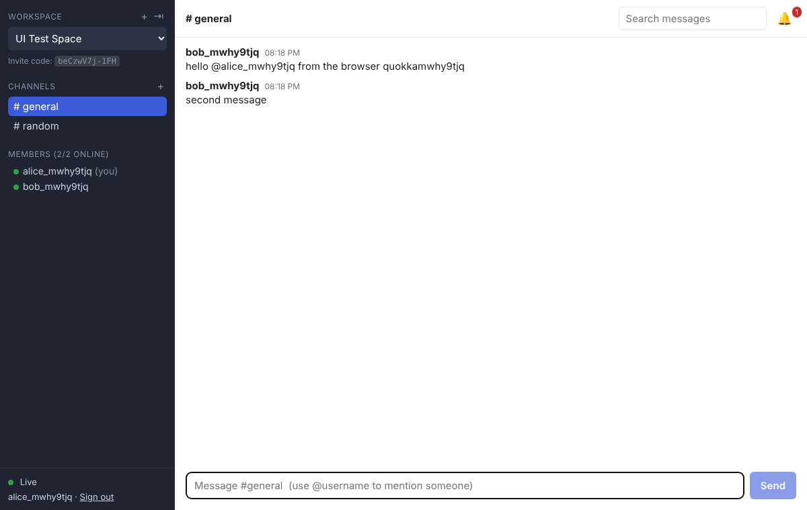
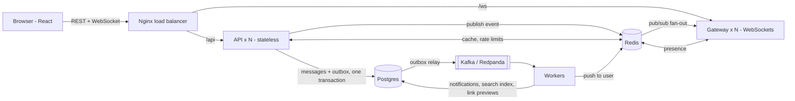

# Relay

A real-time team chat platform in the style of Slack or Discord, built to learn
how a real product is put together and what has to change as it grows.

It is not a tutorial clone. It starts as a simple monolith and is then pushed
through eight scaling problems, each solved the way production systems solve
them, with the reasoning and trade-offs written down.



## What it does

- Sign up, sign in, workspaces with invite codes, public and private channels
- Messages delivered live over WebSockets, typing indicators, online presence
- Unread markers, @mentions with notifications, link previews, full-text search
- Runs as several API and gateway instances behind a load balancer

## Architecture



| Service | Folder | Job | State |
|---|---|---|---|
| API | `apps/api` | REST: auth, workspaces, channels, messages, search | Stateless |
| Gateway | `apps/gateway` | Holds WebSocket connections, fans out events | Connections in memory |
| Workers | `apps/workers` | Outbox relay and Kafka consumers | Stateless |
| Web | `apps/web` | React single-page app | Browser |
| Shared | `packages/shared` | Types, event contracts, pure helpers | Library |

The life of one message, end to end, is in [docs/architecture.md](docs/architecture.md).

## Run it

You need [Docker Desktop](https://www.docker.com/products/docker-desktop/) and
[Node.js 22+](https://nodejs.org).

```bash
docker compose up --build -d      # first build takes a few minutes
```

Open **http://localhost:8080**, create an account, create a workspace, and open
a second browser (or a private window) to sign up a second user and join with
the invite code shown in the sidebar.

Check that everything works:

```bash
npm install
npm run smoke                     # 17 end-to-end checks against the running stack
```

Stop it with `docker compose down` (add `-v` to delete the data too).

### Develop with hot reload

Run only the databases in Docker and the code on your machine:

```bash
npm install
npm run deps:up                   # Postgres, Redis, Redpanda
npm run migrate
npm run dev                       # api, gateway, workers and web, restarting on change
```

Then open http://localhost:5173.

| Command | What it does |
|---|---|
| `npm run dev` | All four apps with reload |
| `npm test` | Unit tests |
| `npm run typecheck` | TypeScript check of every package |
| `npm run migrate` | Apply database migrations |
| `npm run smoke` | End-to-end test against a running stack |
| `docker compose --profile monitoring up -d` | Prometheus (`:9090`) and Grafana (`:3001`) |

If something does not start, see [docs/runbook.md](docs/runbook.md).

## The eight phases

Each phase is one scaling problem. Each document explains what breaks, the fix,
the trade-off, how to see it yourself, and questions an interviewer could ask.

| # | Phase | Problem | Solution in this repo |
|---|---|---|---|
| 1 | [Monolith](docs/phases/01-monolith.md) | Build a correct product first | Data model, REST API, JWT auth, cursor pagination |
| 2 | [Real-time](docs/phases/02-realtime.md) | Users should not have to refresh | WebSocket gateway, heartbeats, reconnect with backoff |
| 3 | [Multiple servers](docs/phases/03-multiple-servers.md) | Users on different servers cannot see each other | Redis pub/sub fan-out, shared presence |
| 4 | [Async work](docs/phases/04-async-work.md) | Slow side effects make sending slow | Transactional outbox, Kafka, idempotent consumers, dead-letter topic |
| 5 | [Read scaling](docs/phases/05-read-scaling.md) | The database does the same reads over and over | Cache-aside in Redis, read-replica support |
| 6 | [Write scaling](docs/phases/06-write-scaling.md) | One giant messages table | Hash partitioning by channel, Snowflake IDs |
| 7 | [Search](docs/phases/07-search.md) | Searching the write table is slow and couples everything | Separate read model built from the event stream |
| 8 | [Production readiness](docs/phases/08-production-readiness.md) | You cannot run what you cannot see | Rate limiting, metrics, health checks, graceful shutdown, CI, Kubernetes |

More documentation:

- [Architecture](docs/architecture.md): components, message flow, failure modes
- [API reference](docs/api.md): every REST endpoint and WebSocket event
- [Design decisions](docs/decisions.md): why each technology and pattern was chosen, and what was rejected
- [Load testing](loadtests/README.md) and [benchmark log](docs/benchmarks.md)
- [Runbook](docs/runbook.md): running, debugging, troubleshooting

## Repository layout

```
apps/
  api/        REST API            src/modules/<feature>/{routes,service}.ts, src/db/migrations/
  gateway/    WebSocket server    hub.ts (routing), presence.ts, server.ts
  workers/    background jobs     outboxRelay.ts, consumer.ts, handlers/
  web/        React app           src/components/, socket.ts, api.ts
packages/
  shared/     types, events, Snowflake IDs, text helpers (with tests)
infra/
  docker/     backend image       nginx/  load balancer + web image
  monitoring/ Prometheus, Grafana k8s/    Kubernetes manifests
loadtests/    k6 scripts
scripts/      smoke.ts (end-to-end test)
docs/         everything explained
```

## Tech stack

TypeScript and Node.js 22, Express, PostgreSQL 16, Redis 7, Redpanda (Kafka
API), `ws`, React 18 with Vite, Nginx, Docker Compose, Prometheus and Grafana,
k6, GitHub Actions.

## What has been tested, and what has not

Being exact about this matters more than looking finished.

**Tested** (before this repository was published, in a sandbox with real
PostgreSQL 16 and Redis 7):

- All four migrations apply cleanly, including converting a populated
  `messages` table to partitions, and re-running the migrator is a no-op.
- The API, two gateways and the workers were run together behind a
  round-robin proxy, and the smoke test passed all 17 checks.
- The web app was driven in a headless browser as two users: signup, invite,
  live messages, typing, presence, unread markers, mentions, search, reload.
- With every Kafka event deliberately delivered twice, there was exactly one
  notification and one search row per message (the consumers are idempotent).
- 28 unit tests pass.

**Not yet tested**, because that sandbox could not download npm packages or run
Docker:

- The run above used small local stand-ins for Express, `pg`, `ioredis`,
  `kafkajs`, `jsonwebtoken`, `bcryptjs`, `pino` and `prom-client`. The code is
  written against the real libraries' documented APIs, but the first
  `npm install` + `docker compose up` on a real machine is the first time they
  meet. Expect that a small fix or two may be needed.
- `docker-compose.yml`, the Dockerfiles, `nginx.conf`, the Prometheus/Grafana
  setup, the GitHub Actions workflow, the k6 scripts and the Kubernetes
  manifests have been written carefully but never executed.
- No load test has been run. [docs/benchmarks.md](docs/benchmarks.md) is an
  empty log for numbers measured on your own machine.

## Known limits

Deliberate simplifications, each explained in the phase documents: tokens
cannot be revoked before they expire; no message editing, deletion, threads or
file uploads; real-time delivery is best effort and repaired from history on
reconnect; the search read model lives in Postgres rather than a search
cluster; Redis and Postgres each run as a single node.
